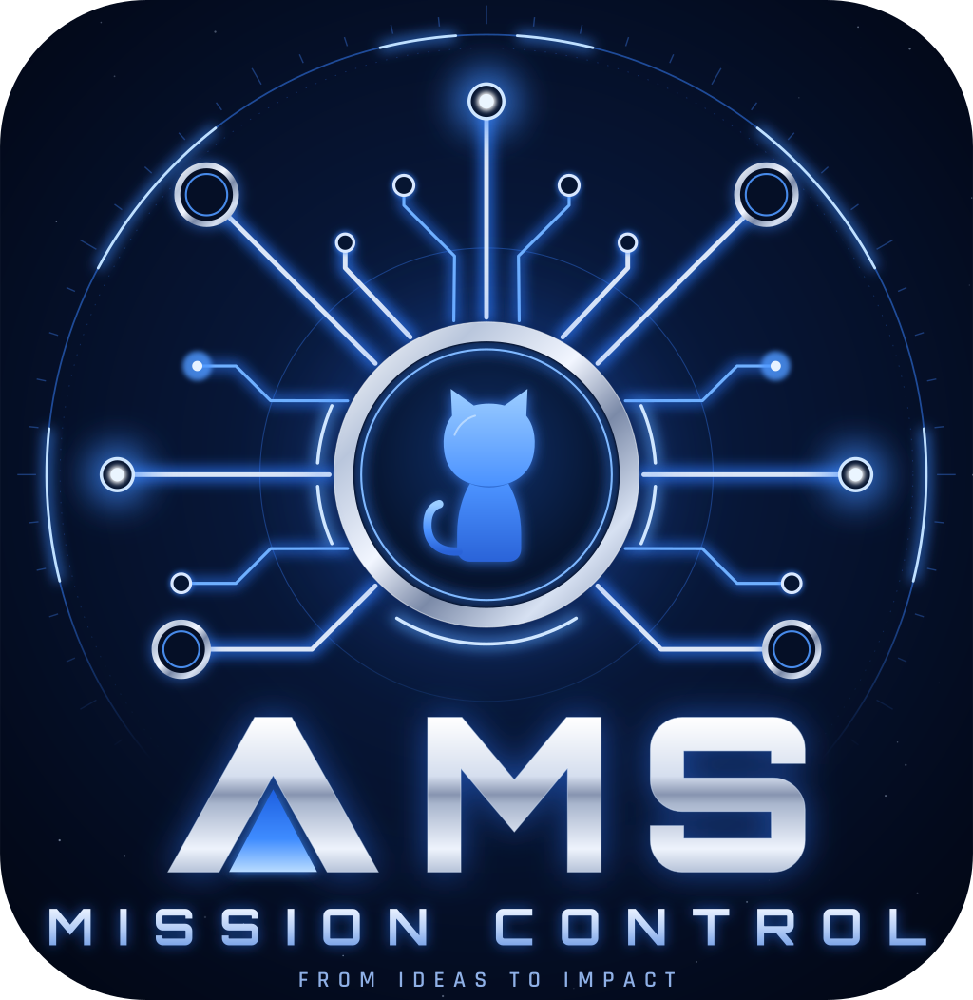
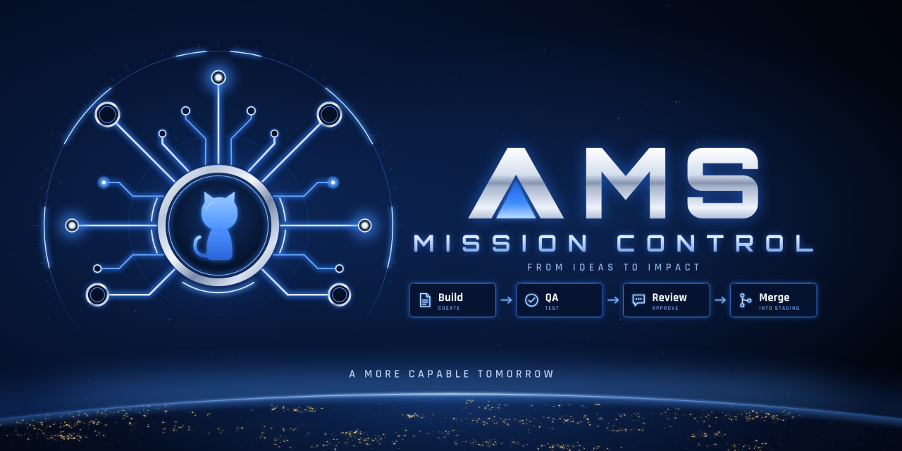
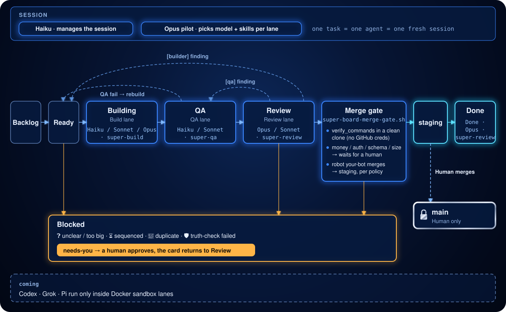
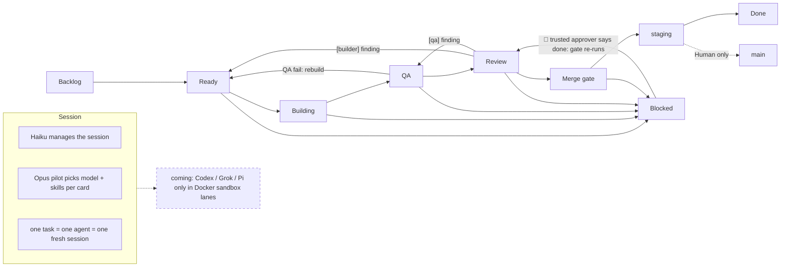

<div align="center">



<h1>AMS Mission Control</h1>

<p><strong>A GitHub Project board that Claude drains: Build → QA → Review → a merge gate into staging.</strong></p>

<p>


</p>

<p><a href="#how-the-board-works">Board</a> · <a href="#lanes-and-who-runs-them">Lanes</a> · <a href="#safety-model">Safety</a> · <a href="#install">Install</a> · <a href="#board-fields">Fields</a> · <a href="#commands-and-skills">Commands</a> · <a href="#more">More</a></p>

</div>



## What it is

This repo ships the `super-board` Claude Code plugin and the `mission-control` router skill. You add cards to the `Ready` column of a GitHub Project board. Lane agents build each card in a worktree, test it, review it, and open a PR into `staging`. A merge gate re-runs your checks in a clean clone; where the board's `merge_policy` allows it, your robot account merges the PR, otherwise the card waits for you. Under the mission-control rules the robot merges only in the pilot repo you name in the mission log; every other repo's merges are yours. `main` stays yours: only the admin can change it.

## How the board works

<picture>
  <source media="(prefers-color-scheme: dark)" srcset="docs/assets/board-flow-dark.svg">
  
</picture>



1. You add a card to `Ready`. The router grades it easy, medium or hard.
2. The Opus pilot fills the card's `Agent` and `Skills` fields. A builder takes it into `Building`: worktree, smallest safe change, tests, draft PR.
3. QA collects evidence, checks for test gaps and takes screenshots. A failing card goes back to `Ready` for a rebuild.
4. Review forms its own hypotheses and writes line-level findings. A `[builder]` finding sends the card to `Ready`; a `[qa]` finding sends it to `QA`.
5. When review passes, the merge gate runs. If `merge_policy` allows, the robot merges the PR into `staging`; otherwise the card goes to `Blocked` for a person.
6. The card moves to `Done` only after the merge is confirmed on the base branch.
7. A card that waits on a person goes to `Blocked` with 🙋 and the `needs-you` label. You either merge the PR yourself, or a trusted approver comments `done` and the next wave moves it back to `Review`, where the gate re-checks it.
8. `main` is yours: only you merge `staging` into it.

Any lane can block a card. Common reasons: ❓ unclear or too big · ⏳ sequenced behind a PR · 👯 duplicate · 🛡 truth-check failed · 🙋 needs you.

## Lanes and who runs them

| Column | Lane skill | Agent field values | What it does |
|---|---|---|---|
| Building | `super-build` | `Haiku · super-build`, `Sonnet · super-build`, `Opus · super-build` | Worktree, smallest safe change, tests, draft PR. |
| QA | `super-qa` | `Haiku · super-qa`, `Sonnet · super-qa` | Evidence, test-gap check, screenshots; a fail goes back to Ready. |
| Review | `super-review` | `Opus · super-review`, `Sonnet · super-review` | Own hypotheses, line-level findings, runs the merge gate. |
| Done | `super-review` | `Done · Opus · super-review` | Marks a merged card; Done means the code is on the base branch. |

Recommended operating rule for mission-control: Haiku manages the session. The Opus pilot picks the model and skills for each card and writes them into `Agent` and `Skills`. One task is one agent in one fresh session. The router grades each card easy, medium or hard; `run`, `run --low` and `run --high` choose the model for each grade. The full table is under "Models" in [plugin/README.md](plugin/README.md#models).

## Safety model

Four layers. The first is the real control; the others sit behind it.

1. **Server rulesets.** `main` is admin-only. `staging` needs one approving review from someone other than the last pusher. These do not depend on command text.
2. **Guard hooks.** worktree-path, secrets, key-literals, delete-outside, gh-identity, merge, config-write, an opt-in protected-push guard, and the `mc-identity-check` SessionStart check. They filter command text and have documented residual bypasses; a green hook test is not a security proof. See [plugin/hooks/README.md](plugin/hooks/README.md).
3. **Merge gate** (`super-board-merge-gate.sh`). It merges the current base into the reviewed commit, runs `verify_commands` in a scrubbed clean clone with no GitHub credentials, and merges only if the PR head is still the reviewed commit.
   - Exit 0: merged.
   - Exit 7: `merge_policy` hit (money, auth, destructive schema, a diff over `merge_policy.auto_max_lines`, or `default: "human"`). The plugin default is 400 lines; mission-control follows the same limit and also holds migrations for the operator. The card goes to Blocked with 🙋 until a person merges it or a trusted approver comments `done` on the pinned request.
   - Exit 8: a human step is needed (for example a migration for an environment outside `migrations.allowed_envs`). The card goes to Blocked with 🙋 and the exact commands to run.
   - Exit 6: the PR head is not the reviewed commit. The evidence is void; the next wave reviews the new head.
   - Exit 11: `notifications.bot_identity` is a login and the acting `gh` login is not it, or the bot is also listed as a trusted approver. The run halts.
   - Exits 2 and 5: verification failed or the base does not merge cleanly; a rebase pass follows. Exits 3, 4, 9: not merged, merge lock busy, or `verify_commands` need repair (halt). Nothing merges on any exit but 0.
   - When it merges, it merges as your robot account (`notifications.bot_identity`) into the board's base branch (`staging` by default in onboard).
4. **Sandbox.** Project commands run in a fresh clone without GitHub access today. Docker sandbox lanes for external CLIs (Codex, Grok, Pi) are planned.

## Install

```
/plugin marketplace add Shahat87/ams-mission-kit
/plugin install super-board@ams-mission-kit
/super-board:super-board onboard
/super-board:super-board run <slug>
```

A marketplace install namespaces the commands (`/super-board:super-board …`); the tables below use the short form that `install.sh` installs.

`onboard` has 8 steps: Checks · GitHub · Board · Branch · AGENTS.md · Policies · Bug sources · Review. It resumes if interrupted. Then add cards to `Ready`.

Or install into the current project without the marketplace:

```bash
curl -fsSL https://raw.githubusercontent.com/Shahat87/ams-mission-kit/main/plugin/get.sh | bash
```

Requirements: Claude Code, `gh`, `jq`, `git`, bash 3.2+, Python 3.9+. On Windows use Git Bash or WSL.

## Cost warning

Runs start Claude sessions, and sessions spend tokens. A run of any size costs more than a
single chat session. The defaults that limit spend:

- Event-triggered lane starts are budgeted: `events.max_starts_per_hour` (default 3) and
  `events.max_starts_per_day` (default 10) in the board config
  (`plugin/skills/super-board/references/config-schema.json`).
- The mission-control autopilot loop caps itself with `batch_size` (default 3 cards per batch)
  and `max_batches` (default 5 batches) in the mission log template
  (`plugin/skills/mission-control/SKILL.md`).

Check these values before long unattended runs.

## Board fields

`onboard` creates these on the board with `super-board-setup.py ensure-fields`. It is idempotent and never deletes or recolors.

| Field | Type | Values |
|---|---|---|
| Agent | single select | `Haiku · super-build`, `Sonnet · super-build`, `Opus · super-build`, `Haiku · super-qa`, `Sonnet · super-qa`, `Opus · super-review`, `Sonnet · super-review`, `Done · Opus · super-review` |
| Skills | text | Skill ids the pilot picked for the card |
| Card type | single select | `feature`, `bug`, `docs`, `money`, `refactor`, `tests`, `ux`, `qa` |

> [!IMPORTANT]
> One manual step: on the board, open the View menu ▾ → Fields → tick **Agent**, **Skills** and **Card type**. GitHub's API cannot change which fields a view shows.

## Commands and skills

| Command or skill | What it does |
|---|---|
| `/super-board onboard` | 8-step setup; resumes. |
| `/super-board lint` | Checks cards for vague acceptance criteria. |
| `/super-board status` | Read-only snapshot of the board. |
| `/super-board run <slug>` | Drains the board (`--low`, `--high`, `--codex` pick models). |
| `/super-board stop` | Stops workers. |
| `/super-collect [source]` | Finds problems (Sentry, PostHog, issues, PRs, architecture) and files verified Backlog cards. |
| `/ui-refine-loop <route>` | Critique and refine loop that polishes one page or component. |
| `/visual [recap\|plan\|path]` | One HTML page: branch recap, plan, or codebase map. |
| `/git-sync` | Commit per logical change, merge-pull, push without force, report. |
| `/mission-control` | Router: picks the skill per phase, hands builds to super-board. |
| `super-build` | Lane the board runs: worktree, smallest safe change, tests, draft PR. |
| `super-qa` | Lane the board runs: evidence, test-gap check, screenshots, or bounce. |
| `super-review` | Lane the board runs: own hypotheses, findings, merge gate. |

That is 9 skills: 6 you type (`super-board`, `super-collect`, `ui-refine-loop`, `visual`, `git-sync`, `mission-control`) and 3 the board runs.

## Repo layout

- `plugin/`: the `super-board` plugin (skills, hooks, scripts, workflows, tests, diagrams).
- `.claude-plugin/marketplace.json`: the `ams-mission-kit` marketplace that lists the plugin.
- `docs/assets/`: images used by this README.
- [SECURITY.md](SECURITY.md): how to report a vulnerability. [CONTRIBUTING.md](CONTRIBUTING.md): how to contribute.

## More

- [plugin/README.md](plugin/README.md): full plugin details.
- [plugin/hooks/README.md](plugin/hooks/README.md): every guard hook and its known bypasses.
- [plugin/RELEASE-NOTES.md](plugin/RELEASE-NOTES.md): release history.
- [plugin/diagrams/index.html](plugin/diagrams/index.html): interactive overview and maps.
- [plugin/diagrams/pstack/](plugin/diagrams/pstack/index.html): pstack map.
- [plugin/diagrams/mattpocock/](plugin/diagrams/mattpocock/index.html): Matt Pocock skills map.
- [plugin/diagrams/impeccable/](plugin/diagrams/impeccable/index.html): impeccable map.
- pstack upstream: [cursor/plugins/pstack](https://github.com/cursor/plugins/tree/main/pstack) · [michael-denyer/pstack-claude](https://github.com/michael-denyer/pstack-claude).

Credits: super-board by AMS Tech (MIT). Built on [obra/superpowers](https://github.com/obra/superpowers), [mattpocock/skills](https://github.com/mattpocock/skills) and pstack (links above).

License: MIT, see [LICENSE](LICENSE).
