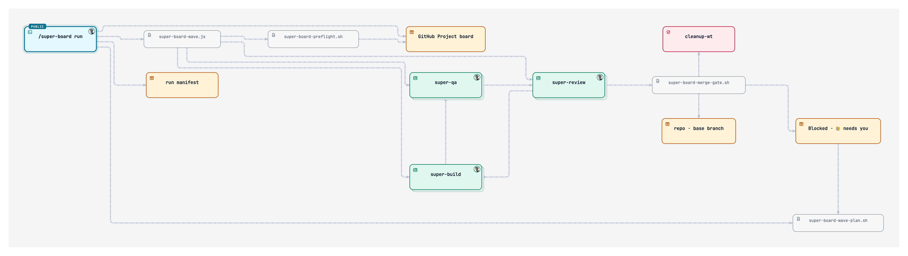

# ams-mission-kit

A Claude Code plugin that runs a GitHub Project board for you. You add cards to the `Ready`
column. Lane agents pick them up, build each card in a git worktree, test it, review it, and
open a pull request. A merge gate re-runs your checks in a clean clone and merges only when
they pass. The plugin ships 9 skills (6 you type, 3 the board runs), guard hooks, and the
scripts that wire them into a project.

## Requirements

- Claude Code
- `gh` (GitHub CLI), signed in
- `git`
- Python 3
- On Windows: Git Bash or WSL (the scripts are bash)

## Install

```
claude plugin marketplace add Shahat87/ams-mission-kit
claude plugin install super-board@ams-mission-kit
```

Then, inside a project:

```
/super-board onboard
```

`onboard` is an 8-step setup (checks, GitHub, board, branch, AGENTS.md, policies, bug sources,
review). It writes the guard hooks, helper scripts and workflows into the project's `.claude/`
tree — a plugin alone cannot ship those.

## 5-minute quickstart

1. Install the plugin (above) and run `/super-board onboard` in your project.
2. Open your GitHub Project and add a card to the `Ready` column. A card is a GitHub issue
   with a short problem statement and acceptance criteria.
3. Run `/super-board run <slug>` where `<slug>` is the config name onboard created.
4. The board drains: cards move Ready → Building → QA → Review, then the merge gate runs your
   `verify_commands` in a clean clone and merges into the base branch (default `main`; onboard suggests `staging` when a
   staging branch exists).
5. Watch progress with `/super-board status`; stop with `/super-board stop`.

When the base branch is `staging`, the board never touches `main`: you merge `staging` into it yourself.

## How the board works

The board runs as a pipeline over your GitHub Project: a card moves
`Backlog → Ready → Building → QA → Review → Done`, one column per lane. When a
card reaches `Ready`, a worker cuts a branch from the base branch and builds
the smallest safe change in its own git worktree. The QA lane tests the result
and can bounce it back to `Building`, and the Review lane writes the PR and
acts as the merge gate. Only when every check passes does the card land in
`Done` as a merged pull request.



## Cost warning

Runs start Claude sessions, and sessions spend tokens. A run of any size costs more than a
single chat session. The defaults that limit spend:

- Event-triggered lane starts are budgeted: `events.max_starts_per_hour` (default 3) and
  `events.max_starts_per_day` (default 10) in the board config
  (`plugin/skills/super-board/references/config-schema.json`).
- The mission-control autopilot loop caps itself with `batch_size` (default 3 cards per batch)
  and `max_batches` (default 5 batches) in the mission log template
  (`plugin/skills/mission-control/SKILL.md`).

Check these values before long unattended runs.

## More

- [`plugin/README.md`](plugin/README.md) — full plugin details: skills, commands, models, hooks.
- [`plugin/RELEASE-NOTES.md`](plugin/RELEASE-NOTES.md) — release history.
- [`plugin/hooks/README.md`](plugin/hooks/README.md) — every guard hook and its known limits.

## License

MIT — see [LICENSE](LICENSE).
