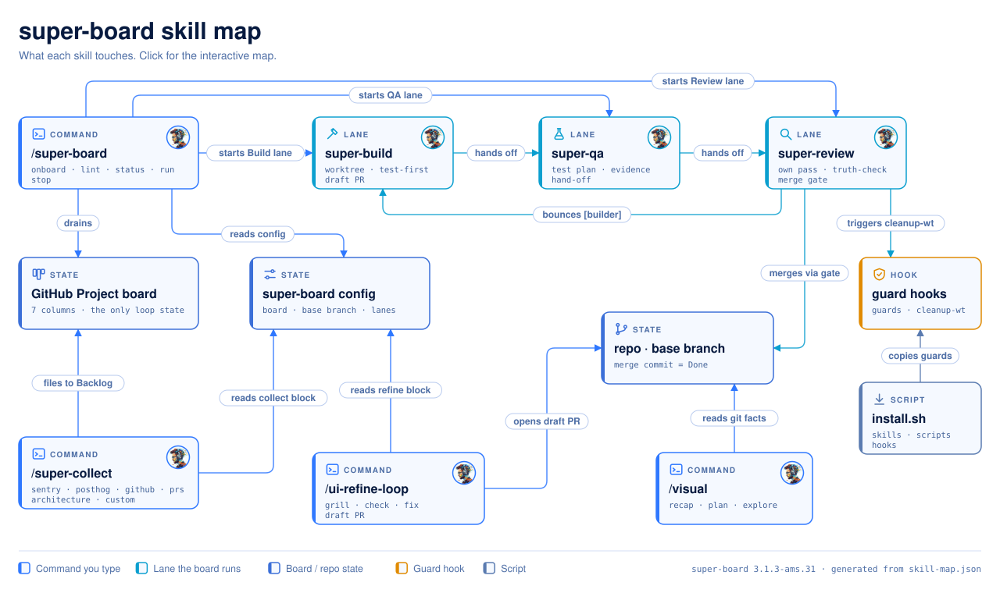

<div align="center">


<h1>super-board</h1>

<p><sub>Maintained by <a href="https://github.com/Shahat87">AMS Tech</a>.</sub></p>

<p><strong>Add tasks, walk away, get merged PRs with proof.</strong></p>

<p>9 skills (6 you type, 3 the board runs) · 9 commands · 9 guard hooks</p>

<p>


</p>

<p><a href="diagrams/index.html"><strong>🌐 Overview page</strong></a></p>

<p><a href="#install">Install</a> · <a href="#quick-start">Quick start</a> · <a href="#how-it-works">How it works</a> · <a href="#skills">Skills</a> · <a href="#commands">Commands</a> · <a href="#guards--hooks">Guards</a></p>

</div>

<p align="center"><a href="diagrams/visual/skill-map.html"><picture><source media="(prefers-color-scheme: dark)" srcset="docs/assets/skill-map-dark.svg"></picture></a></p>
<p align="center"><sub>The skill map. Click it for the interactive version: zoom, pan, open any node.</sub></p>

## Install

In your project folder:

```bash
curl -fsSL https://raw.githubusercontent.com/Shahat87/ams-mission-kit/main/plugin/get.sh | bash
```

Or as a Claude Code plugin:

```
/plugin marketplace add Shahat87/ams-mission-kit
/plugin install super-board@ams-mission-kit
```

> [!NOTE]
> The plugin ships the skills only. Run `/super-board:super-board onboard` and its 🔍 Checks step adds the guard hooks, scripts and workflows. Needs Claude Code, `gh`, `jq`, bash 3.2+ and Python 3.9+; the installer checks.

Optional post-run learning can delegate an already installed `calibrate` skill after
verified selected work completes. It applies only to explicitly permitted existing
canonical skill files; the package bundles no private skill. See
[post-run calibration](skills/super-board/references/calibration.md).

## Quick start

### 1. Install

```bash
curl -fsSL https://raw.githubusercontent.com/Shahat87/ams-mission-kit/main/plugin/get.sh | bash
```

### 2. Onboard

```
/super-board onboard
```

Checks · GitHub · Board · Branch · AGENTS.md · Policies · Bug sources · Review. <kbd>Enter</kbd> takes the recommended answer.

### 3. Run

```
/super-board run my-app
```

Add cards to `Ready`. The board drains on its own.

## How it works

See the [board flow diagram](../README.md#how-the-board-works).

## Skills

**9 skills (6 you type, 3 the board runs).** Uses [Matt Pocock skills](https://github.com/mattpocock/skills), ponytail, impeccable and humanizer.

<!-- skills:start -->
**You type — 6 skills**

| Skill | What it does |
|---|---|
| [`/super-board`](skills/super-board/README.md) | Orchestrator: plans waves, runs Build → QA → Review, merges when green. |
| [`/super-collect`](skills/super-collect/README.md) | Finds problems (Sentry, PostHog, issues, PRs, architecture) and files verified Backlog cards. |
| [`/ui-refine-loop`](skills/ui-refine-loop/README.md) | Critique → refine loop that polishes one page or component. |
| [`/visual`](skills/visual/README.md) | One HTML page: branch recap, plan, or codebase map with diagrams. |
| [`/git-sync`](skills/git-sync/README.md) | Commit per logical change, merge-pull, push without force, report. |
| [`/mission-control`](skills/mission-control/SKILL.md) | The operator's router: picks the skill per phase, hands builds to super-board. |

**The board runs — 3 lanes**

| Skill | What it does |
|---|---|
| [`/super-build`](skills/super-build/README.md) | Builder lane: worktree, smallest safe change, tests, draft PR. |
| [`/super-qa`](skills/super-qa/README.md) | Tester lane: evidence, test-gap check, screenshots, or bounce to Build. |
| [`/super-review`](skills/super-review/README.md) | Reviewer lane: own hypotheses, remembers prior findings, merge gate. |
<!-- skills:end -->

Each name links to that skill's README. Adding a skill? Write its `SKILL.md` and `README.md`, add a line to `skills/families.json`, and this table updates itself.

## Commands

```
/super-board onboard          # 8-step setup, resumes
/super-board lint             # vague ACs?
/super-board status           # read-only snapshot
/super-board run <slug>       # drain the board
/super-board stop             # stop workers
/super-collect [source]       # file problems to Backlog
/ui-refine-loop <route>       # polish one page
/visual [recap|plan|path]     # one HTML page
/git-sync                     # commit, pull, push
```

Flags: `run --low|--high` · `run --codex[=<model>]` · `super-collect --since 30d`

Start the loop with `--model haiku`: the session only manages, and every lane pins its own model.

## Guards & hooks

Run automatically once installed. Python stdlib, JSON in, JSON out.

**Hooks are the second layer, not the control.** They filter command text, and a shell has more ways to
spell a command than any filter closes. The control is the server-side rulesets on the repo: `main` is
admin-only, and `staging` needs one approving review from someone other than the last pusher. Keep them on;
a green hook test is not a security proof. (Details and the known residual bypasses: [hooks/README.md](hooks/README.md).)

| | |
| --- | --- |
| [guard-worktree-path](hooks/guard-worktree-path.py) | Blocks `git worktree add` outside `.claude/worktrees/` |
| [guard-secrets](hooks/guard-secrets.py) | Blocks reading or piping dotenv files, SSH keys and credential files; key names via `super-board-env-check.sh` |
| [guard-key-literals](hooks/guard-key-literals.py) | Blocks a live-looking API key written into a file; flags one already there |
| [guard-delete-outside](hooks/guard-delete-outside.py) | Blocks `rm`, `find -delete` and `git clean` aimed outside the project, `~` or `/` |
| [guard-protected-push](hooks/guard-protected-push.py) | Opt-in (`onboard` asks, or `install.sh --protect-main`): blocks direct and force pushes to main/master/base |
| [README sync](scripts/super-board-readme-sync.py) | Regenerates the skill table; pre-commit and PostToolUse hooks keep it fresh |
| [cleanup-wt](hooks/cleanup-wt.py) | Removes merged worktrees and branches after each merge and at session start, with a recovery file |
| [merge gate](scripts/super-board-merge-gate.sh) | Merges only after the current base plus your non-empty project `verify_commands` pass (missing checks halt setup), pinned to the reviewed commit; applies `merge_policy` and runs allowed DB migrations |

## Models

A cheap router grades each card easy, medium or hard first; the run flag picks the model for each grade. With `--codex`, every lane runs on Codex GPT models instead of Claude.

| Command | Router | Easy card | Medium card | Hard card |
| --- | --- | --- | --- | --- |
| `/super-board run --codex` | gpt-6-luna | gpt-6.1-sol | gpt-6.1-sol | gpt-6-astra |
| `/super-board run --codex --low` | gpt-6-luna | gpt-6-luna | gpt-6.1-sol | gpt-6.1-sol |
| `/super-board run --codex --high` | gpt-6-luna | gpt-6-astra | gpt-6-astra | gpt-6-astra |

`/super-board run --codex=<model>` pins one model for every card and skips the router.

On Claude, each lane has its own ladder (`LANE_LADDERS` in `workflows/super-board-wave.js`), easy / medium / hard card:

| Command | Build | QA | Review |
| --- | --- | --- | --- |
| `/super-board run` | Sonnet / Sonnet / Sonnet | Sonnet / Sonnet / Sonnet | Sonnet / Sonnet / Opus |
| `/super-board run --low` | Haiku / Sonnet / Sonnet | Haiku / Haiku / Sonnet | Sonnet / Sonnet / Sonnet |
| `/super-board run --high` | Sonnet / Sonnet / Sonnet | Sonnet / Sonnet / Sonnet | Sonnet / Sonnet / Opus |

No lane builds on Opus by default. `pilot.models` in the config pins a lane's model; `pilot.enabled` lets an Opus pilot propose models within these rules.

Run inside Codex? plain `/super-board run` switches to the Codex ladder by itself. Codex has no
`/super-board` command: it finds skills in `.agents/skills/` (symlinks followed), so link
`.claude/skills/super-board` there and type `$super-board run`.

## Writing standard

Commits, tickets, PR bodies and comments all follow [one writing standard](diagrams/writing-standard/reference.html), in the pack and in every project it is installed into.

<details>
<summary><strong>Upgrading from 2.x</strong></summary>

1. Re-run the install line.
2. Run `/super-board onboard`; step 1 upgrades for you and keeps a backup.
3. Try `board-migrate --dry-run` on a copy of your board first.

[Full notes](RELEASE-NOTES.md#upgrading-from-2x)

</details>

## Credits

MIT © AMS Tech ([LICENSE](LICENSE)). Built on [obra/superpowers](https://github.com/obra/superpowers), [mattpocock/skills](https://github.com/mattpocock/skills), [BuilderIO/skills](https://github.com/BuilderIO/skills) and [tt-a1i/archify](https://github.com/tt-a1i/archify).

---

<p align="center">
<a href="diagrams/index.html">Overview page</a> ·
<a href="diagrams/visual/skill-map.html">Skill map</a> ·
<a href="diagrams/writing-standard/reference.html">Writing standard</a> ·
<a href="diagrams/onboarding/index.html">Setup simulator</a> ·
<a href="diagrams/impeccable/index.html">Impeccable map</a> ·
<a href="diagrams/pstack/index.html">pstack map</a> ·
<a href="RELEASE-NOTES.md">Release notes</a> ·
<a href="RELEASING.md">Release checks</a> ·
<a href="https://youtu.be/nX_bGyIOFM4">YouTube walkthrough</a>
</p>
<p align="center"><sub>Maintained by <a href="https://github.com/Shahat87">AMS Tech</a></sub></p>

### Worker skill availability

Setup and dispatch resolve real, nonempty `SKILL.md` files for the actual
Claude or Codex host. Missing required skills halt before claims or workers;
lockfiles and arbitrary plugin caches do not count. The shared registry in
`scripts/super-board-skills-ready.py` owns lane dependencies, overrides and the
two declared ponytail fallbacks. Setup's full helper union may be red while a
selected card is runnable. Read-only checks never install; explicit onboard
repair rechecks files after installation.

The CLI accepts `--home <fixture-home>` and `--catalog <active-skills.json>`.
Launchers accept the same inventory through `SUPER_BOARD_SKILLS_HOME` and
`SUPER_BOARD_SKILLS_CATALOG`; neither changes the actual host. Catalog shape:
`{"host":"codex","skills":[{"name":"vendor:skill","path":"/exact/SKILL.md",
"enabled":true,"scope":"project","project_root":"/exact/project"}]}`.
User entries use `scope:"user"`. Restart explicitly after repairing missing
skills; readiness certifies availability, not their content or external tools.
